<div class="absolute top-8 left-8 text-sm opacity-60">PRESENTATION · Nov 2026 · 01</div>

# Email Encryption, Inside Out

### From postcards to private mail — TLS, E2EE, and the road to decentralized email

<br/>

> **The one decision you'll make by the end:** *"Which layer actually protects the thing I care about?"*
> — transport, content, or metadata.

<br/>

<div class="text-sm opacity-70">A blog-style walkthrough · companion doc: <code>GO-DEEPER.md</code></div>

<style>
  h1 { color: #0f766e; }
  code { color: #0f766e; background: #f0fdfa; padding: 1px 5px; border-radius: 4px; }
</style>

<!--
SPEAKER NOTES — 
- TLS: the tunnel to your mail server. In the "postcards vs private mail" framing, TLS protects the *path* (the road the postcard travels), not the words on the card. Set up the talk's core split now: transport ≠ content.
- E2EE: end-to-end encryption of the body, so only sender and recipient hold the keys — the "private mail" the title promises. This is what most people *think* they mean by "the email is encrypted."
- metadata: the who-to-whom envelope (From/To/Subject, timing, size) that stays visible even when the body is E2EE'd. It's the unsolved frontier this whole deck keeps returning to.
- transport vs content: the two independent layers of protection the deck will keep separating. Keep them distinct in your head or the central argument collapses.
- GO-DEEPER.md: the companion doc with the full verified internals; mention it as where the deep `openssl`/`gpg` flows live, so you don't cram them into the talk.
-->

---

<div class="absolute top-8 left-8 text-sm opacity-60">PRESENTATION · Nov 2026 · 02</div>

# The promise of this talk

**GOOD / explicit outcome** — by the end you can *repair* this statement:

> "The email is encrypted."

**Repaired:** *"The **body** is encrypted end-to-end; the **tunnel** to the server is TLS; the **who-to-whom metadata** is still visible."*

| If you care about… | The layer you need |
|---|---|
| Privacy from your provider reading the body | **E2EE** |
| Not being read while in transit | **TLS** |
| Who-talks-to-whom staying hidden | **Not solved by either** → DIDs/mixnets |

> One concept: there is no single switch. There are three separate questions.

<!--
SPEAKER NOTES — 
- E2EE: protects the *body* from the provider reading it — this is the "privacy from provider" row. In the repair example it's the part that says "body encrypted end-to-end."
- TLS: protects the *tunnel* so nobody reads you in transit — the "in-transit safety" row, distinct from content.
- metadata (who-to-whom): the row that says "not solved by either." Make the point that the two famous protections both fail on this question — which is why DIDs/mixnets appear later.
- The three questions: privacy-from-provider, in-transit-safety, who-talks-to-whom. Hammer this: no single switch covers all three, so "the email is encrypted" is always an incomplete sentence.
-->

---

<div class="absolute top-8 left-8 text-sm opacity-60">PRESENTATION · Nov 2026 · 03</div>

# The journey

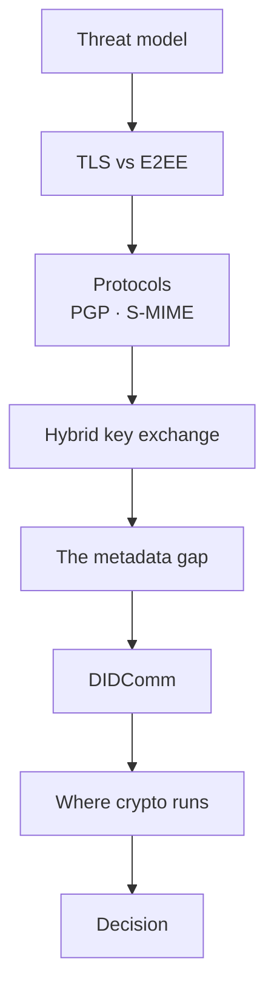

<!--
SPEAKER NOTES — 
- Threat model: the starting point — you decide *who* you're defending against (wiretapper? provider? government?) before any crypto choice. Everything downstream maps back to this slide.
- TLS vs E2EE: the two-layer split (transport vs content) that frames the whole talk.
- PGP · S/MIME: the two E2EE families that answer "how is a public key bound to a person."
- Hybrid key exchange: how a fast symmetric cipher is combined with a slow asymmetric one — the engine of all these protocols.
- The metadata gap: the visible envelope problem, the unsolved frontier.
- DIDComm: the decentralized messaging layer that tries to close that gap.
- Where crypto runs: the hardware (Secure Enclave/TPM/smart card) that holds private keys.
- This is the roadmap — you can tick off where you are as you go.
-->

---

# Part 1 · The threat model

> **The idea:** standard email is an *open postcard*. Encryption adds an *envelope*.

**Form follows example:** a process → a labelled flow.

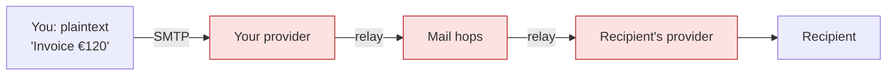

> **Readable at every red hop** — your provider, every relay, the recipient's provider. No envelope yet.

<!--
SPEAKER NOTES — 
- open postcard metaphor: plaintext email is readable by everyone who touches it, just like a postcard is readable by anyone who handles the mail.
- SMTP: the protocol that carries mail from server to server across hops — note the red hops (your provider, relays, recipient's provider) are exactly the parties you want to keep out, but the protocol hands them the plaintext.
- plaintext: the unencrypted message ('Invoice €120') that every hop sees. No envelope = no protection yet.
- The red shading marks where an attacker could read it. The point: ordinary email has *many* red hops, not one.
-->

---

# There are TWO separate protections

> **One concept:** *transport* and *content* are independent layers. "Email encryption" usually means one, not both.

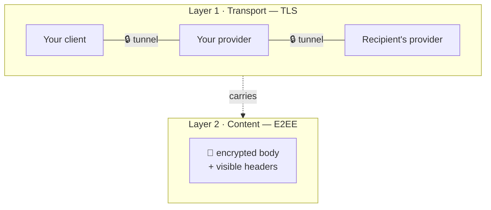

| Layer | Protects | Provider can still read… |
|---|---|---|
| **TLS** (in transit) | The pipe between servers | The body at rest |
| **E2EE** (content) | The message itself | Headers only |

<!--
SPEAKER NOTES — 
- TLS: protects the *pipe between servers* — so a passive wiretapper can't read in transit, but the provider still sees the body at rest on disk. That's the red-row contrast.
- E2EE (content): protects the *message itself* — so the provider still sees the headers but not the body. Note it's the inverse of TLS: TLS loses at rest, E2EE loses on headers.
- headers: the routing/metadata fields (From/To/Subject/Date) — visible in both cases here, which foreshadows the whole metadata part.
- The two layers are independent and *complementary* — that's why the deck calls them Layer 1 (transport) and Layer 2 (content). Neither substitutes for the other.
-->

---

# Layer 1 · TLS — the tunnel

> **One concept:** TLS protects the *connection*, not the message.

**Worked example — two hops, no content protection:**

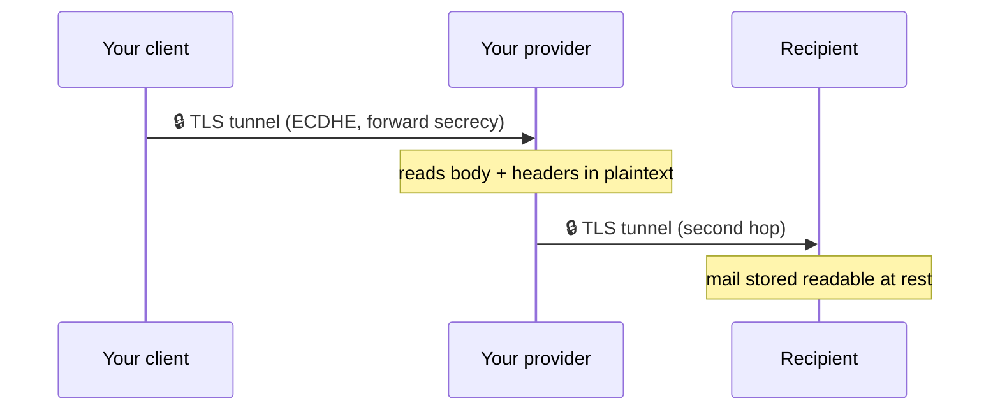

> **Result:** the pipe is safe from a passive wiretapper — but **your provider still reads everything**. TLS is not E2EE.

<!--
SPEAKER NOTES — 
- TLS tunnel: a protected connection between two endpoints; here each hop (client→provider, provider→recipient) is its own separate tunnel.
- ECDHE / forward secrecy: the ephemeral key exchange that means past sessions stay safe if the long-term key is later stolen — that's the "forward secrecy" tag on the tunnel. But note it only protects *in transit*.
- The two-hop detail is the whole lesson: the tunnel stops at your provider, so your provider reads the body *and* headers in plaintext (the Note-over-P red flag). A second tunnel doesn't help because the message is re-readable at the relay.
- at rest: mail stored unencrypted on disk by the provider — "readable at rest" is the failure mode TLS never addresses.
- Why this matters: most users assume "encrypted" = safe; this slide shows TLS alone leaves the provider holding everything.
-->

---

# Layer 2 · E2EE — the content

> **One concept:** E2EE encrypts the *body* so only sender and recipient hold the keys.

**Transformation:**

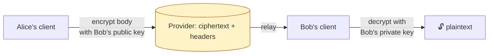

> **Result:** the provider stores and relays a blob it **cannot read**. Headers (From/To/Subject) are still visible.

<!--
SPEAKER NOTES — 
- E2EE: the body is encrypted so only Alice and Bob hold the keys; the provider never does.
- encrypt with Bob's public key: anyone can encrypt *to* Bob using his public key — that's why Alice can send safely without a pre-shared secret.
- decrypt with Bob's private key: only Bob's private key (which he alone holds) can reverse it. Public key locks, private key unlocks.
- ciphertext: the opaque blob the provider stores and relays — it's literally unreadable ("a blob it cannot read").
- The yellow blob node is the provider: it still sees the headers, which is the *metadata* teaser. Body is safe; the envelope leaks.
-->

---

# Part 2 · The two E2EE families

> **The one question that separates them:** *how is a public key bound to a real person?*

**Form follows example:** a tradeoff → an aligned comparison.

| | **OpenPGP** | **S/MIME** |
|---|---|---|
| Identity binding | **Web of Trust** — keys sign keys | **X.509 CA** — trusted root signs cert |
| Standard | RFC 4880 → **RFC 9580** (2024) | **RFC 8551** (v4.0, 2019) |
| Who vouches | Your peers | A certificate authority |
| Typical clients | Thunderbird, Proton, GPG | Apple Mail, Outlook, GWSMO |

> Two ways to answer "whose key is this?" — one peer-to-peer, one hierarchical.

<!--
SPEAKER NOTES — 
- OpenPGP: the open-standard PGP family; binds identity through the *Web of Trust* — your peers sign each other's keys, so trust is peer-to-peer.
- Web of Trust: keys sign keys. There's no central authority; you trust Bob because Carol (whom you trust) vouches for him. Decentralized but brittle.
- S/MIME: the CA-based family; binds identity through a *trusted root* that signs certificates — a hierarchical trust chain, one authority at the top.
- X.509 CA: the certificate-authority model where a trusted root certifies identities; the flip side of the Web of Trust.
- The one question — "how is a public key bound to a real person?" — is the lens for everything: PGP answers "your peers," S/MIME answers "an authority." That's the entire difference between the two families.
- RFC 4880→9580 vs RFC 8551: just the standard version numbers; don't linger unless asked.
-->

---

# PGP / OpenPGP — the timeline

> **One concept:** PGP the product became OpenPGP the *open standard*.

**Transformation — 1991 → 2024:**

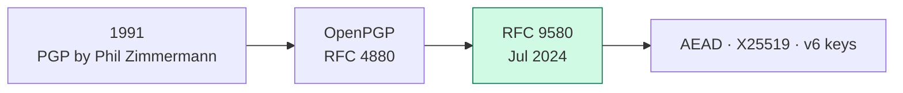

- **PGP** — proprietary software, Zimmermann 1991, now owned by **Broadcom**.
- **OpenPGP** — the open standard (RFC 4880 → **RFC 9580**, July 2024) so implementations interoperate.
- RFC 9580 adds **AEAD**, **Argon2**, **X25519/X448**, **v6 keys**.
- ⚠️ **Post-quantum (ML-KEM/ML-DSA) is still an IETF draft** — not in RFC 9580.

<!--
SPEAKER NOTES — 
- PGP: the original proprietary product by Phil Zimmermann (1991), now owned by Broadcom. The *brand*, not the standard.
- OpenPGP: the open, standardized version (RFC 4880, then RFC 9580 in July 2024) so different implementations interoperate. PGP-the-product became OpenPGP-the-standard.
- RFC 4880 → RFC 9580: the standard's evolution — 9580 (2024) is the modern update that added AEAD, Argon2, X25519/X448 and v6 keys.
- AEAD: authenticated encryption — the ciphertext is also integrity-checked, so a tampered message is rejected, not just hidden. Why it matters here: older OpenPGP lacked proper authentication, a real weakness.
- Argon2: the password-hashing function used to derive a key from a passphrase, making brute-forcing the passphrase expensive.
- X25519/X448: modern elliptic-curve (Edwards-curve) key exchange used to share keys; much faster/smaller than legacy RSA, which is why RFC 9580 embraces them.
- v6 keys: the new OpenPGP key format that supports the modern algorithms.
- ML-KEM/ML-DSA: the post-quantum algorithms (NIST-standardized) that *will* replace the above once the IETF draft lands — flag that quantum-safe OpenPGP isn't final yet.
-->

---

# OpenPGP trust · the Web of Trust

> **One concept:** trust flows because *people sign each other's keys* — there is no central authority.

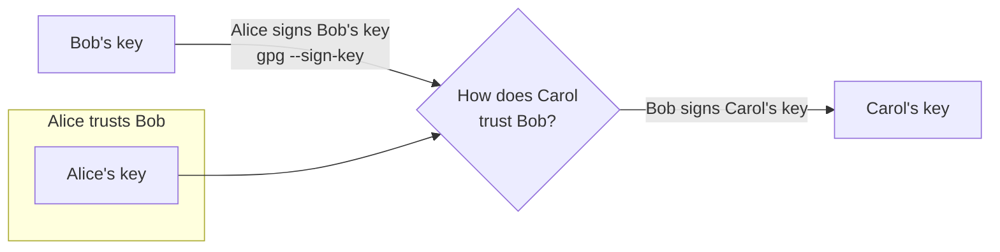

> **Weakness (honest):** chains are brittle; no authority means no revocation-by-default. That's the price of no central CA.

<!--
SPEAKER NOTES — 
- Web of Trust: trust is transitive — Alice trusts Bob, Bob signs Carol's key, so Alice can decide to trust Carol. No central authority certifies anyone.
- gpg --sign-key: the actual command that makes Alice vouch for Bob's key — the mechanism by which the web is built.
- No central CA: the defining tradeoff. Because there's no root authority, there's no single point to *revoke* a key when it's compromised — revocation is opt-in and often never happens.
- Brittle chains: if the linking person's key is compromised or unreachable, the trust path breaks. A revoked-but-not-reported key is the honest failure.
- This is the price of decentralization — and the reason S/MIME chose the opposite, hierarchical model (next slide).
-->

---

# S/MIME trust · the CA hierarchy

> **One concept:** trust is anchored in a **root CA** your client already has in its trust store.

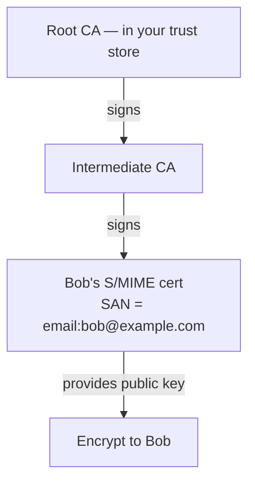

> **Chain check:** each signature valid under the parent's key → root is trusted → cert accepted. Break any link → warning.

<!--
SPEAKER NOTES — 
- Root CA: the topmost certificate authority, already pre-installed in the client's trust store — trust is anchored here, unlike the Web of Trust.
- trust store: the client's local list of roots it blindly accepts. The chain is only trusted if it ends at a root the store recognizes.
- Intermediate CA: a middle tier signed by the root, which in turn signs leaf certs — lets the root avoid signing everything directly.
- Leaf: Bob's actual S/MIME certificate — the bottom of the chain that carries his public key.
- SAN = email:bob@example.com: the field tying the cert to Bob's real mailbox (SAN = Subject Alternative Name) — the part the client matches against the sender.
- Chain check intuition: like verifying a driver's license — you trust the DMV (root), the DMV authorized the regional office (intermediate), which issued this license (leaf). Break any link and you distrust the whole thing.
-->

---

# Platforms at a glance

> **One concept:** the same two protocols, deployed very differently. *Form: one table, no repetition.*

| Platform | Standard | Subject encrypted? | Key storage | Notes |
|---|---|---|---|---|
| **Proton Mail** | OpenPGP | ❌ | Client (JS) | Body E2EE; subject plaintext for interop |
| **Tuta** | **TutaCrypt** | ✅ | Client-side | X25519 + Kyber-1024; subject privacy |
| **Thunderbird** | OpenPGP + S/MIME | ✅ | Local (GPG) | "Encrypt Subject" **pre-dates** RFC 9788 |
| **Apple Mail** | S/MIME | ❌ | Keychain / SE | P-256 vs RSA split → Part 7 |
| **Outlook (M365)** | S/MIME (+PGP) | ❌ | Windows cert store | Enterprise CA deployment |
| **Gmail Workspace** | S/MIME (hosted) | ❌ | Google-managed | Server-side S/MIME, GWSMO client |
| **PGPony** | OpenPGP | ✅ | **Smart cards** (NFC/USB) | Card-backed keys; active |
| **OpenKeychain** | OpenPGP | — | User-space RAM | Unmaintained (v6.0.4, Feb 2024) |

<style>
  table { font-size: 0.72rem !important; }
</style>

<!--
SPEAKER NOTES — 
- OpenPGP / S/MIME: the two E2EE families from Part 2 — the table shows how the same two protocols get deployed differently per platform.
- TutaCrypt: Tuta's own protocol (X25519 + Kyber-1024) that also encrypts the subject — the ✅ in "Subject encrypted?" is the standout.
- X25519 + Kyber-1024: hybrid key agreement — X25519 (classic ECC) plus Kyber (a post-quantum KEM, here the older Kyber-1024 variant) so it's quantum-resistant. Later superseded by ML-KEM.
- Keychain / SE: Apple's credential storage and its Secure Enclave hardware — the "where crypto runs" foreshadow for Part 7.
- P-256 vs RSA: ECC vs RSA key types — Apple Mail's S/MIME split that matters for hardware key storage; flagged for Part 7.
- Key storage column: client-side (Proton), smart cards (PGPony), hardware (Keychain), Google-managed (GWSMO) — the whole Part 7 theme in one row.
- RFC 9788: the header-protection standard Thunderbird's "Encrypt Subject" pre-dates; it's NOT an implementation of it (Part 5).
- Subject encrypted? ❌ vs ✅: whether the subject line (metadata) is hidden — the practical E2EE-vs-metadata gap in a glance.
- PGPony / OpenKeychain: two OpenPGP Android clients — PGPony is active & card-backed, OpenKeychain is unmaintained. Contrast matters for "where crypto runs."
- This is a reference table — don't read it aloud; point at the interesting cells.
-->

---

# What a certificate actually is

> **One concept:** a certificate is a **signed public key** — it binds a key to an identity, and is attested by a signature. It **never contains the private key**.

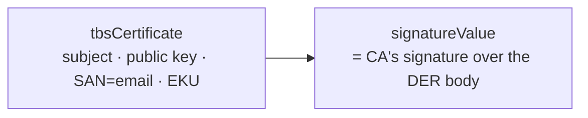

| S/MIME-specific field | Value |
|---|---|
| **Subject Alternative Name** | `email:alice@example.com` |
| **Extended Key Usage** | `id-kp-emailProtection` → **OID `1.3.6.1.5.5.7.3.4`** ⚠️ not `.3.12` |
| **Key Usage** | `digitalSignature` + `keyEncipherment` |

<!--
SPEAKER NOTES — 
- tbsCertificate: "to-be-signed certificate" — the structured part (subject, public key, SAN, EKU) that the CA actually signs. The signature is over this body, which is why tampering with it breaks the signature.
- signed public key / signatureValue: a cert is literally a public key plus an authority's signature over it — it *never* contains the private key, ever.
- Subject Alternative Name (SAN): the field that binds the cert to a specific mailbox, here `email:alice@example.com`. The verifier checks the sender's From: against this — a cert for the wrong address fails at this step.
- Extended Key Usage (EKU): says what the cert is *allowed* to do — here `id-kp-emailProtection`, i.e. "this cert is for email." The OID `1.3.6.1.5.5.7.3.4` is the exact identifier; the ⚠️ is because it's easy to mis-write (some docs use the wrong trailing `.12`).
- OID: Object Identifier — a globally unique dotted number that names a thing (here: a usage policy). `.3.4` = emailProtection; getting it wrong breaks S/MIME validation.
- Key Usage: a stricter field limiting what the key may be used for — `digitalSignature` (signing) and `keyEncipherment` (wrapping a session key). The two distinct jobs the key is allowed to do.
- Intuition: a certificate is like an ID card — it proves the *public* key belongs to Alice and is only for email; the private half is never on the card.
-->

---

# Generation · how a sender gets a certificate

> **One concept:** a key pair is born, the public half gets signed, the private half never leaves you.

**Transformation — input → process → output:**

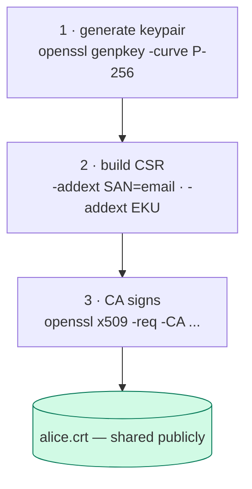

> **What's shared is `alice.crt`.** The private key stays secret and never travels.

<!--
SPEAKER NOTES — 
- keypair: the pair of mathematically linked keys — the public key (shared) and private key (kept secret). Generate once, use for years.
- openssl genpkey -curve P-256: the command creating an ECC keypair on the P-256 curve — `-curve P-256` picks the modern ECC option rather than RSA.
- CSR (Certificate Signing Request): the request you build (`-addext SAN=email · -addext EKU`) that asks a CA to sign your public key — it carries your public key plus the identity fields you want in the cert. It is *not* the certificate yet.
- SAN=email / EKU: the identity and usage claims you're requesting in the CSR — the CA decides whether to grant them.
- CA signs: `openssl x509 -req -CA ...` — the CA produces `alice.crt`, a signed certificate binding your public key to your email.
- alice.crt: the only artifact shared publicly. The private key is never transmitted — it stays on Alice's machine. That asymmetry (share cert, keep key) is the whole security model.
-->

---

# Part 3 · Hybrid key exchange

> **One concept:** combine a fast symmetric cipher with a slow-but-shareable asymmetric one.

**The problem it solves:**

| Symmetric (AES) | Asymmetric (RSA/ECC) |
|---|---|
| Very fast, but needs a shared key | Solves sharing, but ~1,000× slower |

> **Both are needed:** AES encrypts the bulk fast; RSA/ECC safely shares the key. Neither alone is enough.

<!--
SPEAKER NOTES — 
- Hybrid key exchange: the pattern of pairing a fast symmetric cipher with a slow-but-shareable asymmetric one. The whole reason "hybrid" appears everywhere in email crypto.
- Symmetric (AES): same key encrypts and decrypts — very fast, great for bulk data, but both parties must already share that key.
- Asymmetric (RSA/ECC): different keys for encrypt/decrypt — solves the key-sharing problem (one party can publish a public key), but ~1000× slower, unusable for bulk.
- AES: the standardized block cipher used for the fast bulk encryption. It can't share keys by itself.
- RSA/ECC: the asymmetric schemes that share keys but are too slow for the message body.
- Intuition: AES is a fast lock everyone uses for the payload; RSA/ECC is the slow but safe courier that hands AES its key. The problem they solve together is "how to safely get a shared key to the recipient."
-->

---

# The hybrid — input → transform → outcome

> **One concept:** encrypt the body with AES, wrap the tiny session key with the recipient's public key.

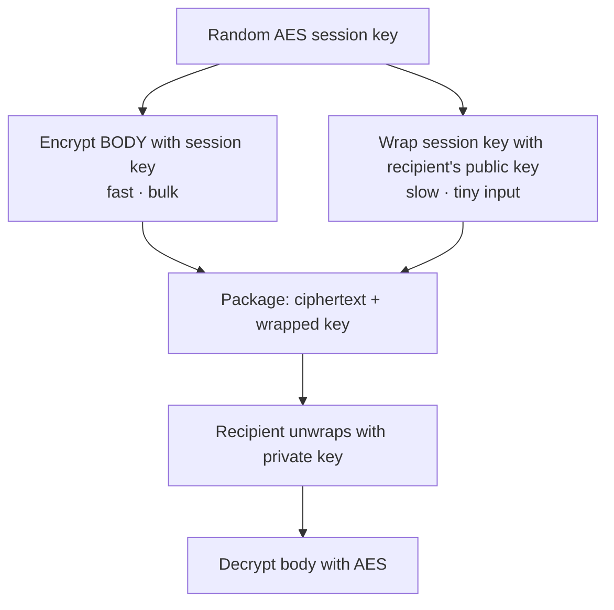

> The slow asymmetric op runs **once, on ≤256 bits**. That's the core trick.

<!--
SPEAKER NOTES — 
- session key: a fresh, random symmetric key generated *per message* — used to encrypt the body, then thrown away. It's tiny (≤256 bits), which is why the slow op can afford to wrap it.
- AES: the fast symmetric cipher that encrypts the whole (large) body with the session key — bulk work done fast.
- wrap the session key with recipient's public key: the asymmetric (RSA/ECC) operation that seals just the tiny session key so only the recipient's private key can unwrap it.
- The core trick: the expensive asymmetric math runs exactly once, on a tiny input (the ≤256-bit session key), not on the whole message. If it had to run on the body, email would be unbearably slow.
- unwrap with private key → decrypt body with AES: the receiver reverses it — unwrap the key, then use AES on the big payload.
-->

---

# Multi-recipient

> **One concept:** encrypt the body once; wrap the same session key for each recipient.

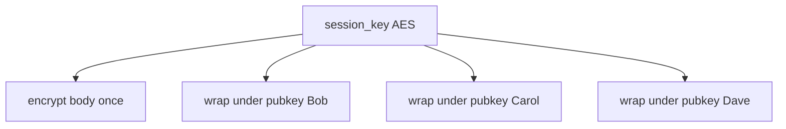

> Each recipient finds **their own wrapped copy** of the session key and decrypts it with their own private key.

<!--
SPEAKER NOTES — 
- multi-recipient: sending the same message to several people without encrypting the body N times.
- session_key AES: one shared symmetric key for the whole message — encrypt the body *once*.
- wrap under pubkey Bob/Carol/Dave: the same session key gets individually wrapped with each recipient's public key. Each wrap is a separate little ciphertext only that recipient can open.
- Why it's efficient: the body (the big, expensive-to-encrypt part) is done once; only the tiny key-wraps multiply. 3 recipients = 1 body encryption + 3 key wraps.
- Intuition: one locked box (AES body) with several keys — you give each recipient their own key to the same box, rather than copying the box per recipient.
-->

---

# Receiver validates & decrypts

> **One concept:** the client *cryptographically verifies* the chain up to a trusted root, then decrypts.

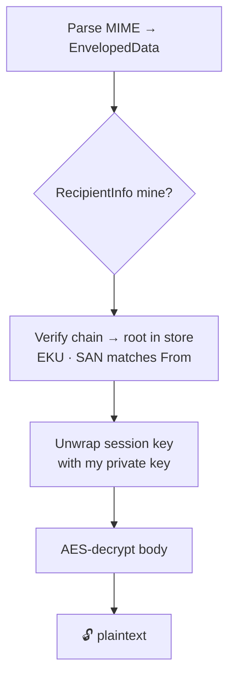

> **No magic:** chain invalid or root untrusted → warning/block. Otherwise → accept and decrypt.

<!--
SPEAKER NOTES — 
- EnvelopedData: the CMS structure that carries the encrypted content plus the per-recipient wrapped keys — the "envelope" part of S/MIME.
- RecipientInfo: the per-recipient block inside EnvelopedData holding *that* recipient's wrapped copy of the session key. "Mine?" = does any block match my key/cert?
- CMS: the Cryptographic Message Syntax standard (RFC 5652) that S/MIME is built on — the generic container, of which EnvelopedData is the encryption flavor.
- Verify chain → root in store: walk the cert chain (leaf → intermediate → root) and confirm the root is in the client's trust store — the same hierarchy check from the S/MIME trust slide.
- EKU · SAN matches From: two checks — the cert's Extended Key Usage allows email, and its Subject Alternative Name matches the sender's From: header. A cert for the wrong mailbox is rejected here.
- Unwrap session key → AES-decrypt: only now, after trust checks pass, does the client use its private key to unwrap the session key and AES-decrypt the body.
- Intuition: the client refuses to even decrypt unless the identity and trust checks pass first — "verify, then decrypt," never the reverse.
-->

---

# Part 4 · The secrets

> **One concept:** there are **two kinds** of secret, with very different blast radii.

| Secret | Lifetime | If it leaks |
|---|---|---|
| **Private key** | Years | Entire mailbox history **+ future** — no recovery, no rotation fixes the past |
| **Passphrase** | Years | Unlocks the private key → same as above |
| **Session key** | One message | Only that message |

> **Design goal:** minimize the blast radius of any one compromise. The session key limits per-message damage; the private key is the real risk.

<!--
SPEAKER NOTES — 
- private key: the long-lived secret (years) that decrypts your entire mailbox — both history *and* future. If it leaks, everything is readable, and there's no recovery.
- passphrase: the password protecting the private key. It's *not* the key itself — it just unlocks it. Leak it and an attacker can unlock the key; its blast radius is the same as the key's.
- session key: the per-message key. Leak *it* and only that single message is exposed — the smallest blast radius.
- blast radius: how much damage one leaked secret does. The whole design goal is to shrink it — push secrets toward short-lived, single-message keys and away from the long-lived private key.
- Intuition: a house key (private) opens every room forever; a per-visit passcode (session key) only opens today's door. Encrypt to make the per-visit passcode the default.
-->

---

# The forward-secrecy gap

> **One concept:** PGP/S-MIME use a *static* private key forever, so there is **no forward secrecy**.

**Form: a comparison — same scenario, two key models.**

| Scenario | TLS 1.3 (ephemeral DH) | PGP / S-MIME (static key) |
|---|---|---|
| Private key stolen in 2026 | Past sessions safe (ephemeral keys destroyed) | **All** messages ever encrypted exposed |
| One session key intercepted | No added risk | Only that one message |

> Signal's **Double Ratchet** (ephemeral key exchange) gives forward secrecy in messaging — it does **not** exist in classic email E2EE.

<!--
SPEAKER NOTES — 
- forward secrecy: if the long-term private key is later stolen, past sessions stay safe — because each session used a *fresh, destroyed* key rather than the long-term one. The key test: "was there anything worth stealing from last year's traffic?"
- ephemeral Diffie-Hellman (ephemeral DH): each session generates temporary (ephemeral) key-exchange keys, used once and discarded — the mechanism that creates forward secrecy in TLS 1.3.
- TLS 1.3: modern TLS with ephemeral keys — hence its row says past sessions survive a 2026 key theft.
- static key: PGP/S-MIME reuse one private key forever — so a stolen key retroactively exposes *all* messages ever encrypted to it. No forward secrecy.
- Double Ratchet: Signal's mechanism of ratcheting (advancing) ephemeral keys per message so each message has a fresh key — gives forward secrecy in messaging, but has **no** email E2EE equivalent.
- Intuition: forward secrecy is like a hotel that shreds your room key after checkout — stealing the master key later opens nothing from before. Static email keys are a master key that opens every past room.
- One session key intercepted row: if a single message's session key leaks, TLS and PGP both expose only that message — the difference is the *long-term* key compromise row, where PGP fails catastrophically.
-->

---

# Part 5 · The metadata problem

> **One concept:** an encrypted *body* still leaks an unencrypted *envelope*.

**Transformation — what the server sees:**

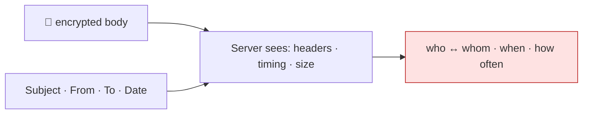

> The message is secret; **the envelope is public** — and the envelope is a communication graph.

<!--
SPEAKER NOTES — 
- metadata: the *envelope* rather than the *content* — who talked to whom, when, how often, how big. The body is encrypted (🔐) but the envelope is not.
- Subject · From · To · Date: the visible headers that carry the metadata — the sender, recipient, and topic are exposed even though the body is safe.
- timing · size: the second-order leaks — when a message was sent and how large, which are also metadata even without headers.
- communication graph: the pattern of who-connects-to-whom that an observer can reconstruct from the envelope — arguably as revealing as the content itself. Knowing Alice emails Bob every Friday at 9am leaks a lot.
- Intuition: it's like a sealed letter inside a clear glass envelope — the letter is private, but everyone in the post office sees the address, the stamp date, and the weight.
-->

---

# Protocol fix · RFC 9788 (subject)

> **One concept:** move sensitive headers *into* the encrypted payload, show a placeholder outside.

**Transformation — Subject line:**

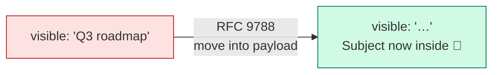

- **RFC 9788** (Aug 2025) standardizes this for **PGP and S/MIME**; adds end-to-end integrity for all headers.
- ⚠️ Thunderbird's "Encrypt Subject" **predates and is not an implementation of** RFC 9788.
- Does **not** solve From/To — SMTP needs them visible for routing.

<!--
SPEAKER NOTES — 
- RFC 9788: the 2025 standard (for PGP and S/MIME) that moves sensitive headers *into* the encrypted payload and shows a placeholder ('…') outside, plus adds end-to-end integrity for all headers. The subject is the big win.
- The transform shown: "Q3 roadmap" → '…' — the visible subject becomes a placeholder because the real one now lives inside the encrypted body.
- Subject: the header this fixes — hidden behind the ciphertext once moved into the payload.
- Why it doesn't fix From/To: SMTP needs a resolvable recipient (and a valid sender) to *route* the mail — if you hide To, no server knows where to deliver it. So those headers must stay visible by protocol necessity.
- Thunderbird "Encrypt Subject" vs RFC 9788: an important honest distinction — Thunderbird's feature predates and is *not* an implementation of the standard; don't credit it as such.
- end-to-end integrity: the standard also authenticates headers, so a relay can't tamper with them — a bonus beyond just hiding the subject.
-->

---

# Transport fix · Encrypted Client Hello

> **One concept:** hide which mail server you're connecting to, not just the bytes you send.

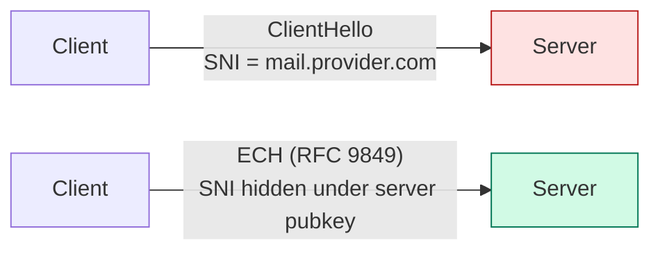

- **ECH (RFC 9849, March 2026)** encrypts the SNI (and ALPN) in the TLS handshake under an HPKE key.
- Observers no longer see *which* server you reach. A transport-level privacy win.

<!--
SPEAKER NOTES — 
- Encrypted Client Hello (ECH): a TLS feature (RFC 9849, March 2026) that encrypts part of the TLS handshake's first message so an observer can't see which server you're connecting to.
- ClientHello: the first TLS message a client sends, which normally reveals the target server via SNI.
- SNI (Server Name Indication): the field in the ClientHello that says "I want mail.provider.com" — normally visible in plaintext, which tells a wiretapper which server you're reaching.
- ALPN: the field declaring which protocol (e.g. HTTP/2, SMTP) the client wants — ECH also hides this.
- HPKE: Hybrid Public Key Encryption — the mechanism ECH uses to encrypt the SNI/ALPN under a server public key, so only that server can read them.
- Why it matters here: with ECH, an observer sees "someone is doing TLS" but not *to which mail server* — a metadata win at the transport layer, complementary to RFC 9788's content-layer fix.
-->

---

# Architectural workarounds (available now)

> **One concept:** sidestep the protocol; change *where* the encryption happens.

| Approach | How it hides metadata | Example |
|---|---|---|
| **Zero-access provider** | Custom protocol encrypts subject/contacts **client-side** | Tuta (TutaCrypt), Proton (body only) |
| **Sealed sender** | Sender's identity encrypted inside the envelope; server sees an opaque blob + delivery token | Signal (2018) — **no email equivalent yet** |

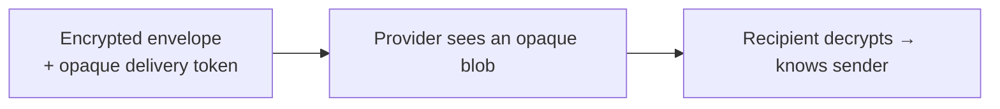

> Signal's **sealed sender** (Oct 2018): the model any future "sealed email" would follow.

<!--
SPEAKER NOTES — 
- sealed sender: hiding the *sender's identity* from the server — the sender is encrypted inside the envelope, and the server only sees an opaque blob plus a delivery token. The recipient (who can decrypt) learns who sent it.
- zero-access provider: a provider whose custom protocol encrypts data (subject/contacts) client-side so the provider itself can't read it — e.g. Tuta via TutaCrypt, Proton (body only). "Zero access" = the provider holds ciphertext it can't open.
- opaque blob: a ciphertext the provider can't interpret — it knows a message arrived and where to deliver it, but not who sent it or what's inside.
- delivery token: a routing hint that lets the provider forward the blob to the right recipient *without* reading the sender.
- Why no email equivalent yet: SMTP fundamentally needs a resolvable From for the routing/bounce model, so "sealed email" can't just bolt on — it needs the redesign discussed on the next slide.
- Intuition: sealed sender is a return address written in invisible ink — the post office delivers the letter but can't read who mailed it.
-->

---

# What's still unsolved

> **One concept:** From/To and timing/size are exposed *because SMTP requires them for routing*.

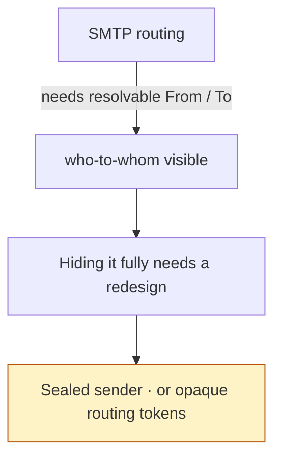

> **Honest limit:** no deployed email standard hides *who talks to whom* today. That's the hardest problem — and the reason for the next part.

<!--
SPEAKER NOTES — 
- SMTP routing: the protocol needs a resolvable From/To to decide *where to deliver the mail* — so those addresses can't be encrypted without breaking delivery.
- resolvable From/To: the visible addresses that make routing work — the exact metadata that leaks who↔whom.
- who-to-whom visible: the core unsolved leak. Encrypting the body (E2EE) and the subject (RFC 9788) and the destination (ECH) still leaves *the connection between two identities* exposed.
- Hiding it fully needs a redesign: you can't patch this into SMTP — you need a new transport, which is what sealed sender / opaque routing tokens would provide.
- sealed sender / opaque routing tokens: the two candidate mechanisms — hide the sender in the envelope (sealed sender) or use unreadable tokens for delivery.
- Intuition: even a fully encrypted letter shows the postman who sends mail to whom; no deployed email standard fixes that today. This honest limit is the *motivation* for Part 6 (DIDs).
-->

---

# Part 6 · DIDs — opaque identifiers

> **One concept:** replace `alice@gmail.com` with an opaque, user-controlled identifier.

**Transformation:**

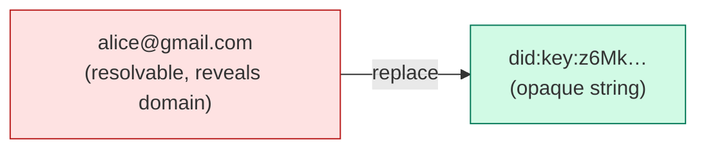

- An observer sees only an opaque string — **no name, no domain**.
- The **W3C DID spec lists privacy as a design goal** (Recommendation, July 2022).
- ⚠️ **Terminology:** `did:key` is generative/registry-less. **Veres One** (`did:v1`) is a separate method. Don't conflate them.

<!--
SPEAKER NOTES — 
- DID: Decentralized Identifier — a user-controlled, opaque identifier that replaces a resolvable email address. The point here is it reveals *no name and no domain*.
- did:key: a DID method that's *generative/registry-less* — the identifier is *derived directly from the public key* (z6Mk… is base58 of the key), so there's no registry to consult. Fast, self-contained, but it *is* the key.
- opaque string: `did:key:z6Mk…` — an observer sees a random-looking string with no name or domain, so it leaks nothing about who you are or where you're hosted.
- Veres One / did:v1: a *separate* DID method with its own registry/ledger — easy to confuse with did:key because both start with "did:". The slide's ⚠️ is a call to keep them distinct.
- W3C DID spec: the W3C DID Core Recommendation (July 2022) that explicitly lists privacy as a design goal — the standard backing the "opaque identifier" claim.
- Intuition: did:key is an ID card made of the key itself (no issuing office); Veres One is an ID card issued by a ledger. Both are DIDs; different mechanics.
-->

---

# DIDComm — the messaging layer

> **One concept:** DIDComm (v2, DIF-ratified — *not* an IETF RFC) hides the sender from intermediaries.

| Mode | What it hides |
|---|---|
| **anoncrypt** (ECDH-ES) | Sender identity from everyone except the recipient |
| **authcrypt** (ECDH-1PU) | Sender identity provable to the **recipient only** |

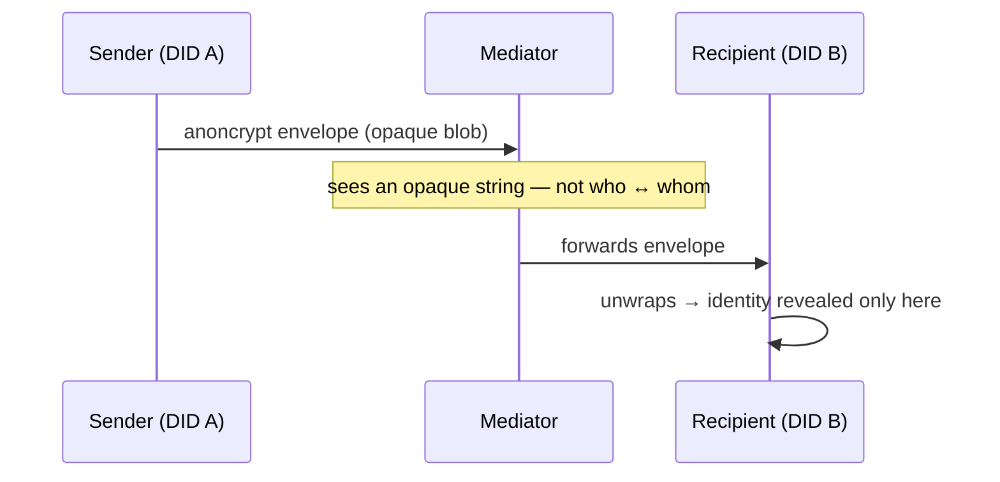

<!--
SPEAKER NOTES — 
- DIDComm v2: the messaging layer *built on* DIDs (ratified by DIF, not an IETF RFC — worth stating, since it's decentralized and standards-young). It lets messages travel through intermediaries without revealing the sender.
- anoncrypt (ECDH-ES): anonymous encryption — the sender encrypts so that *anyone except the recipient* (including intermediaries) can't see who sent it. "ES" = Ephemeral-Static: a fresh ephemeral key combined with the recipient's static key.
- authcrypt (ECDH-1PU): authenticated encryption — only the *recipient* can cryptographically prove the sender's identity, but no one else (including the mediator) can. "1PU" = one-pass unified model, sender's key also folded in.
- Mediator: the intermediary that relays DIDComm envelopes — it sees an opaque blob, not who↔whom, which is exactly the metadata win.
- ECDH: Elliptic Curve Diffie-Hellman, the key agreement the two modes use to derive a shared secret.
- Intuition: anoncrypt is a letter with no return address visible to the courier; authcrypt is a letter where only the recipient can verify the signature — the courier can't.
- The sequence diagram is the money shot: the mediator's Note-over-M is "sees an opaque string" and identity is revealed only at R — point at that line.
-->

---

# DIDComm vs centralized email

> **One concept:** the same three dimensions — privacy, architecture, encryption — but different answers.

| Dimension | Centralized (SMTP + E2EE) | DIDComm + DIDs |
|---|---|---|
| Identity | `name@domain` (resolvable) | Opaque `did:key:…` |
| Privacy | Metadata visible to relays | anoncrypt/authcrypt hide sender |
| Architecture | Central relays / MX | Mediators, transport-agnostic (SMTP possible) |
| Encryption | Hybrid AES + long-term keys | ECDH-ES / ECDH-1PU envelopes |
| Standard | IETF RFCs (mature) | DIF-ratified — **no RFC, no DID-routed mail** |
| Deployment | Ubiquitous | **Experimental** |

<!--
SPEAKER NOTES — 
- SMTP + E2EE: the mature centralized stack — `name@domain` addresses resolved via MX relays, hybrid encryption with long-term keys, mature IETF RFCs, ubiquitous deployment.
- DIDs / DIDComm: the decentralized alternative — opaque `did:key:` identities, mediators instead of MX, anoncrypt/authcrypt envelopes, DIF-ratified (no RFC), experimental deployment.
- resolvable vs opaque identity: `name@domain` reveals the domain (and maps to a person); `did:key:…` reveals nothing — the privacy core of the DID approach.
- Mediators vs central relays/MX: decentralized message-forwarding nodes vs the fixed MX hierarchy — the architectural shift.
- ECDH-ES / ECDH-1PU: the envelope encryption modes (anon vs auth) from the previous slide — the encryption column here.
- The honest bottom line: DIDComm wins on privacy and identity opacity but is *experimental* and has no RFC or deployed DID-routed mail — it's the roadmap, not the product. Don't oversell it.
-->

---

# Why DIDs don't close the gap

> **One concept:** DIDs are a necessary building block, **not** a complete fix. Three leaks remain.

| Leak | Why it happens |
|---|---|
| **Correlation** | Reuse a DID → observers map your graph (W3C DID Core §10.2) |
| **DID doc leaks** | Resolution is a network request; a service endpoint like `https://alice.example.com/inbox` evaporates privacy (§10.6) |
| **No routing standard** | SMTP still needs a resolvable address; **Mailchain shut down May 2026** — it's experimental |

> Ephemeral DIDs fix correlation but break verification ("how do I know it's really you?") and create key-management overhead.

<!--
SPEAKER NOTES — 
- correlation: if you reuse the same DID everywhere, an observer can link all your messages into one graph — "we saw DID X talk to DID Y," reconstructing who-you-talk-to over time. §10.2 of W3C DID Core is the citation.
- DID doc leaks / §10.6: resolving a DID is itself a network request; if your DID document advertises a service endpoint like `https://alice.example.com/inbox`, that URL *reintroduces* the metadata (your server hostname) you were trying to hide. Resolving leaks too.
- No routing standard: SMTP still needs a resolvable address to route, and there's no DID-native routing standard — evidence is that Mailchain (a DID-routed mail service) shut down in May 2026. It's experimental, not settled.
- Ephemeral DIDs: generate a new DID per use to defeat correlation — but then you lose *verifiability* (a fresh DID has no history to prove it's really you) and add key-management overhead.
- Intuition: DIDs are a building block, not a fix. They move the leak around (correlation, resolution, routing) rather than eliminating it — three separate leaks remain.
-->

---

# Where DIDs actually help

> **One concept:** as a **complement**, not a replacement.

```mermaid {scale: 0.85}
flowchart LR
    DID[DID identity layer] --> A[Authenticate without<br/>revealing identity]
    DID --> B[Selective disclosure<br/>'over 21' via ZKPs]
    DID --> C[Identity for a<br/>sealed-sender-like transport]
```

> You still need the **transport layer** (sealed sender / mixnets) to hide *that a message was sent at all*, and **ephemeral identity rotation** to prevent correlation. Mixnets weaken *linkability*, not the existence of traffic.

<!--
SPEAKER NOTES — 
- complement, not replacement: DIDs are a piece of the puzzle — they authenticate *without revealing identity*, enable selective disclosure, and provide identity for sealed-sender transports, but they can't do it alone.
- sealed sender: the transport that hides the sender inside the envelope (Signal-style) — DIDs give it a privacy-preserving identity to work with.
- mixnet: a network that relays messages through multiple hops with shuffling/delays so it's hard to link a sender to a recipient — the "hide that a message was sent at all" tool. It weakens *linkability* (tying two identities together) but not the mere *existence* of traffic.
- linkability: the ability to connect a sender and recipient; mixnets attack this. But traffic still exists and timing/size still leak — mixnets don't make messaging invisible, just un-linkable.
- selective disclosure / ZKPs: proving a claim (e.g. "over 21") without revealing the underlying identity data — a DID-powered capability. ZKP = zero-knowledge proof.
- ephemeral identity rotation: changing DIDs regularly to stop correlation, at the cost of verifiability (from the prior slide).
- The punchline: DIDs are necessary but insufficient — you still need transport-layer hiding and identity rotation to close the gap.
-->

---

# Part 7 · Where does the crypto actually run?

> **One concept:** the hybrid design maps to **two physical places** — and the session key is the bridge that crosses them.

```mermaid {scale: 0.4}
flowchart TB
    subgraph HW["🔒 Secure boundary: SE · TPM · smart card"]
        K[Private key] --> U[unwrap session key]
    end
    U -->|"session key EXITS here"| R[(Regular RAM / CPU)]
    R --> AES[AES-decrypt body]
    AES --> PT[🔓 plaintext]
```

| Operation | Where it runs | Why |
|---|---|---|
| Asymmetric (unwrap session key) | Secure hardware (if configured) | Small, fast, key never leaves |
| Symmetric (AES body decrypt) | Regular CPU + RAM | Bulk data — can't fit in an enclave |

<style>
  table { font-size: 0.78rem !important; }
</style>

> **The unavoidable gap:** the session key and plaintext always transit regular memory.

<!--
SPEAKER NOTES — 
- secure boundary (SE · TPM · smart card): the tamper-resistant hardware where the private key lives — Secure Enclave, Trusted Platform Module, or a smart card's own CPU.
- private key → unwrap session key: the asymmetric operation happens *inside* the secure hardware (if configured) — small and fast, and the key never leaves the chip.
- session key EXITS here: the critical detail — the unwrapped session key is handed *out* of the secure boundary into regular RAM/CPU to run the bulk AES decrypt.
- Regular RAM/CPU: general-purpose memory/processor that holds the session key and then the plaintext — not hardware-protected.
- Why asymmetric runs in hardware but symmetric doesn't: the unwrap is small and slow-so-it-can-afford-the-chip; AES over a whole message is bulk data that "can't fit in an enclave" — it has to run on the main CPU.
- The unavoidable gap: the hybrid design's price — you can lock the private key in hardware, but the session key (and resulting plaintext) *always* comes out into regular memory. This is the seed of the whole Part 7 thesis.
-->

---

# Apple · two paths to the same gap

> **One concept:** the key's *location* depends on how you got it — and most certs are RSA in Keychain.

| Key type | Private key lives | Decryption runs |
|---|---|---|
| **ECC P-256 (SCEP enrollment)** | **Secure Enclave** (generated inside) | Inside the SE (ECDH) |
| **RSA (PKCS#12 import)** — most CAs | Keychain (encrypted at rest) | Regular CPU (Security framework) |

> ⚠️ The Secure Enclave **only accepts P-256 keys generated inside it** — you cannot import an existing RSA or P-256 key. Most CAs issue RSA, so the common case runs in **regular memory**.

<!--
SPEAKER NOTES — 
- Secure Enclave (SE): Apple's dedicated, on-chip hardware security processor that holds keys and does crypto without the main OS ever seeing them.
- ECC P-256 (SCEP enrollment): an elliptic-curve key on the P-256 curve, created via SCEP (a certificate enrollment protocol) — because it's *generated inside* the SE, it can decrypt inside the SE.
- RSA (PKCS#12 import): an RSA key brought in as a PKCS#12 bundle (a standard file format for exporting/importing certs+keys) — the way most CAs deliver S/MIME certs. Since it's imported, it can't live in the SE.
- Keychain: Apple's encrypted-at-rest credential store — RSA keys sit here, encrypted on disk but used by the regular CPU's Security framework (i.e. not in a hardware enclave).
- The catch / ⚠️: the SE refuses *imported* keys — only keys born inside it. So despite Apple Mail supporting S/MIME, most certs (RSA from CAs) end up decrypted in **regular memory**, not the SE. The "two paths" converge on the same unavoidable session-key gap from the previous slide.
- Intuition: the SE is a vault that only accepts items minted inside it; keys delivered from outside (which is most of them) must live in a normal cabinet instead.
-->

---

# Android · why PGP stays in user-space

> **One concept:** the Keystore can't represent OpenPGP — and even when it could, the session key still comes back.

> ⚠️ **Correcting a myth:** Android Keystore/KeyMint **does** support RSA decryption. The real gap:

| Gap | Detail |
|---|---|
| Key types | OpenPGP's X25519/Ed25519, multi-key packets don't map to KeyMint ops |
| Padding / key access | Fixed paddings, no raw key material |
| Session key | Unwrapped key is returned to the app **anyway** — no hardware boundary |

- **OpenKeychain:** unmaintained (last v6.0.4, Feb 2024).
- **PGPony:** hardware-key-first — keys on **NFC/USB smart cards** do crypto **on-card**.
- **BSI (2016):** Keystore would need significant extension for OpenPGP.

<!--
SPEAKER NOTES — 
- Android Keystore / KeyMint: Android's hardware-backed key storage service (KeyMint is the modern version running in the Trusted Execution Environment). It *does* support RSA decryption — the slide corrects the myth that it doesn't.
- The real gap: it can't represent OpenPGP — X25519/Ed25519 and multi-key packets don't map to KeyMint's operations, and it forces fixed paddings with no raw key material access.
- X25519/Ed25519: the modern OpenPGP algorithms (Edwards-curve key exchange / signature) that Android's Keystore doesn't expose as operations — a format/algorithm mismatch, not a missing feature.
- multi-key packets: OpenPGP keys can bundle several subkeys/expiry in one packet structure — KeyMint can't express that.
- session key returned anyway: even when possible, the unwrapped session key is handed back to the app — no hardware boundary on the sensitive value. This is the recurring Part 7 theme.
- OpenKeychain: the Android OpenPGP app, but unmaintained (last v6.0.4, Feb 2024) — keys live in user-space RAM.
- PGPony: the hardware-key-first alternative — keys on NFC/USB smart cards do the crypto *on-card*, unlike the Keystore approach.
- BSI (2016): Germany's federal cybersecurity agency — their 2016 analysis concluded the Keystore would need significant extension to support OpenPGP. That's the authoritative citation for why Android PGP stays in user-space.
-->

---

# GnuPG + TPM 2.0 · shadowed keys

> **One concept:** the TPM wraps your key; the decrypt happens *inside* the chip.

```mermaid {scale: 0.52}
sequenceDiagram
    participant g as gpg
    participant a as gpg-agent
    participant t as tpm2daemon
    participant T as TPM
    g->>a: decrypt, key grip = XYZ
    a->>t: shadow tpm2-v1 → divert
    t->>T: TPM2_Load (81000001)
    t->>T: TPM2_RSA_Decrypt(session key)
    T-->>t: session key (in TPM)
    t-->>a: session key → RAM
    a-->>g: AES-decrypt body
```

> `tpm2daemon` exposes only **IMPORT · PKSIGN · PKDECRYPT · KILLTPM2D**. The shadowed `tpm2-v1` key is useless without *that exact* TPM — but the session key is in RAM the moment it leaves.

<!--
SPEAKER NOTES — 
- TPM 2.0: the Trusted Platform Module — a discrete security chip that generates and uses keys that never leave it.
- shadowed key: a "tpm2-v1" key — on disk it's just a *reference* (a shadow) to a key that exists only inside the TPM, unusable anywhere else.
- key grip: GnuPG's internal identifier for a key ("key grip = XYZ") used to reference it in requests.
- gpg-agent: GnuPG's key/decryption daemon — the component that actually talks to crypto backends; gpg hands it the request.
- tpm2daemon: the GnuPG backend that bridges gpg-agent to the TPM — exposing only four operations: IMPORT, PKSIGN (sign), PKDECRYPT (decrypt), KILLTPM2D (shut down).
- TPM2_Load (81000001): the TPM command that loads the key into the chip (handle 81000001) so it can be used.
- TPM2_RSA_Decrypt: the TPM command performing the RSA decrypt of the session key *inside the chip*.
- The catch: the decrypt happens in the TPM (good — the key never leaves), but the *resulting session key* is returned to RAM for the AES body-decrypt. "The session key is in RAM the moment it leaves" — the recurring hybrid-design gap.
-->

---

# GnuPG + smart card · a self-contained HSM

> **One concept:** the private key physically lives on the card and can **never be exported**.

```mermaid {scale: 0.55}
sequenceDiagram
    participant g as gpg
    participant a as gpg-agent
    participant s as scdaemon
    participant C as Card (own CPU)
    g->>a: decrypt
    a->>s: key on card (stub → serial)
    s->>C: APDU: VERIFY(PIN) → DECRYPT
    Note over C: PIN on-card · 3 tries → lockout
    C-->>s: session key (via APDU)
    s-->>a: regular RAM
    a-->>g: AES-decrypt body
```

> No ISO 7816 command reads the key. PIN is never sent in plaintext. **The session key still exits the card.**

<!--
SPEAKER NOTES — 
- smart card / HSM: a self-contained device with its own CPU and storage that holds the private key *on-card*; a miniature HSM (Hardware Security Module).
- scdaemon: the GnuPG component that talks to smart cards — gpg-agent routes card-backed requests through it.
- key on card (stub → serial): on the host, the key file is just a *stub* identifying the card serial number — the real key lives on the card and can never be exported.
- APDU: the command language (Application Protocol Data Unit) the host sends to the card — here `VERIFY(PIN)` then `DECRYPT`. It's how software talks to a smart card.
- PIN on-card · 3 tries → lockout: the PIN is verified by the card's own CPU, and after 3 wrong tries the card locks — a brute-force defense (this is the PIN retry/lockout mechanism).
- ISO 7816: the smart-card standard defining the APDU command set — and crucially, *no* ISO 7816 command can read the private key out of the card. The key is physically unreadable.
- The unavoidable detail: even with the card doing the decrypt, the *session key* it outputs travels via APDU back into regular RAM for the AES body-decrypt. "The session key still exits the card" — same hybrid-design gap, one more time.
-->

---

# The universal session-key exit

> **One concept:** every platform protects the *private key*; none protects the *session key* in the open.

```mermaid {scale: 0.38}
flowchart TB
    subgraph B1["🔒 Secure boundary"]
        K[Private key] --> OP[asymmetric op] --> SK[session key]
    end
    SK -->|"EXITS (unavoidable)"| RAM[(REGULAR RAM / CPU)]
    RAM --> AES[AES decrypt] --> PT[🔓 plaintext]
```

| Private key in… | Session key in RAM? | Plaintext in RAM? |
|---|---|---|
| TPM / smart card / Secure Enclave / TEE | **Yes (exits)** | Yes |

> **That's the price of the hybrid design:** the private key can be locked away, but the session key always comes out.

<!--
SPEAKER NOTES — 
- Secure boundary: the shared term across TPM, smart card, Secure Enclave, and TEE — the tamper-resistant hardware that holds the private key.
- asymmetric op → session key: inside the boundary, the private key unwraps the session key — the small, chip-appropriate operation.
- EXITS (unavoidable): the session key is handed into REGULAR RAM/CPU — the same gap shown three times now (SE, KeyMint, TPM, smart card). This is the universal pattern.
- REGULAR RAM / CPU: the general memory that holds the session key *and* the resulting plaintext — not hardware-protected.
- TEE: Trusted Execution Environment (e.g. ARM TrustZone) — another kind of secure boundary that still hands the session key out.
- The table says it plainly: regardless of where the private key lives, the session key is *always* in RAM and the plaintext is always in RAM.
- The takeaway: hardware protects the crown-jewel private key, but the hybrid design's session key is the unavoidable weak point. The next slide asks how to close *that* gap.
-->

---

# Threat model & how to close the gap

> **One concept:** hardware shrinks the window — it can't eliminate it.

| Attack | Protected | Exposed |
|---|---|---|
| Steal key file at rest | Private key (SE/TPM/card) | Nothing useful |
| Root OS / dump RAM | Private key (in hardware) | **Session key + plaintext** |
| Cold-boot (freeze RAM) | Private key (in hardware) | Session key + plaintext |
| Physical attack on chip | SE / StrongBox | TPM (not certified vs physical) |

**What closes the gap?**
1. **AES in the enclave** — no SE/TEE/TPM streams AES at mail speed.
2. **Confidential computing** (SGX/CCA/TDX) — key + plaintext stay in encrypted CPU memory.
3. **Post-quantum + hardware** — ML-KEM (RFC 9936) specified for S/MIME; nothing decrypts it.

<!--
SPEAKER NOTES — 
- The table maps attacker scenarios to what's protected vs exposed: hardware (SE/TPM/card) reliably protects the *private key at rest*, but root/OS access, RAM dumps, and cold-boot still expose the *session key and plaintext*.
- Steal key file at rest: attacker grabs the encrypted key file — hardware-bound keys make this useless ("Nothing useful").
- Root OS / dump RAM: attacker with full control reads memory — the session key + plaintext are sitting in RAM, exposed.
- Cold-boot: freezing RAM to preserve contents after power-off and reading them — again exposes the in-RAM session key/plaintext.
- Physical attack on chip: attacking the hardware directly — Secure Enclave / StrongBox resist this (SE = Apple's enclave, StrongBox = Android's high-security version), but a TPM isn't certified against physical attack.
- AES in the enclave: running the bulk AES inside secure hardware — but no SE/TEE/TPM streams AES at mail speed today, so this closes the gap in principle but isn't practical yet.
- Confidential computing (SGX/CCA/TDX): keeping key *and* plaintext in encrypted CPU memory so even the host OS can't read them — the big architectural hope. SGX (Intel), CCA (Arm), TDX (Intel).
- ML-KEM (RFC 9936): the post-quantum KEM now *specified* for S/MIME — combining it with hardware means even a future quantum computer "nothing decrypts it."
- StrongBox: Android's tamper-resistant dedicated security hardware, stronger than the normal Keystore.
-->

---

# The decision, revisited

> **GOOD / the choice you leave with** — "which layer protects what I care about?"

```mermaid {scale: 0.72}
flowchart LR
    A["Body privacy?<br/>→ E2EE"] --> D[Decide]
    B["In-transit safety?<br/>→ TLS"] --> D
    C["Who-to-whom?<br/>→ not solved today"] --> D
```

- **Know your layers** — TLS ≠ E2EE.
- **Private key = crown jewel**, and it has **no forward secrecy**.
- **Metadata** is the unsolved frontier (RFC 9788, ECH, sealed sender).
- **DIDs/DIDComm** are the roadmap, not the finished product.
- **Secure hardware narrows** the blast radius but can't stop the session-key exit.

<!--
SPEAKER NOTES — 
- The decision tree: three questions, three different answers — Body privacy? → E2EE. In-transit safety? → TLS. Who-to-whom? → not solved today (DIDs/mixnets are the roadmap).
- TLS ≠ E2EE: the single most important distinction — one protects the tunnel, the other the message; they are not interchangeable.
- private key = crown jewel: the long-lived key with the largest blast radius, and it has *no forward secrecy* — stealing it exposes all past (and future) mail.
- Metadata: the unsolved frontier — the why of RFC 9788, ECH, and sealed sender.
- DIDs / DIDComm: the roadmap, not the finished product — necessary building blocks but still experimental.
- Secure hardware (SE/TPM/card): narrows the blast radius by protecting the private key, but can't stop the session key from exiting into RAM — the unavoidable hybrid-design gap.
- This slide is the recap/decision: send the audience out able to *repair* "the email is encrypted" into the three-layer truth they've now seen built.
-->

---

# Further reading

Open the companion **`GO-DEEPER.md`** for the full, verified internals — complete `openssl`/`gpg` command flows, TPM shadow-key and smart-card APDU details, and every RFC citation.

**Key references (all verified, Nov 2026)**

- OpenPGP: **RFC 9580** (2024) · S/MIME: **RFC 8551** · CMS: **RFC 5652** · X.509: **RFC 5280**
- Header Protection: **RFC 9788** (Aug 2025) · ECH: **RFC 9849** (Mar 2026) · ML-KEM for S/MIME: **RFC 9936** (Mar 2026)
- DIDs: **W3C DID Core** (Jul 2022) · **DIDComm v2** (DIF)
- Apple Platform Security Guide · Android KeyMint docs · GnuPG manual

<style>
  li { font-size: 1.02rem; line-height: 1.55; }
  table { font-size: 0.95rem; }
</style>

<!--
SPEAKER NOTES — 
- GO-DEEPER.md: the companion doc with the full verified internals — complete `openssl`/`gpg` command flows, TPM shadow-key and smart-card APDU details, and every RFC citation. Point here for anything you didn't cover live.
- RFC 9580: OpenPGP standard (2024). RFC 8551: S/MIME v4.0. RFC 5652: CMS (the message container). RFC 5280: X.509 certificates. These are the four backbone standards cited across the talk.
- RFC 9788: header protection (Aug 2025). RFC 9849: Encrypted Client Hello (Mar 2026). RFC 9936: ML-KEM for S/MIME (Mar 2026) — the recent, forward-looking fixes.
- W3C DID Core (Jul 2022): the DID standard. DIDComm v2 (DIF): the messaging layer. The decentralized roadmap sources.
- Apple Platform Security Guide / Android KeyMint docs / GnuPG manual: the authoritative vendor sources for the "where crypto runs" hardware claims.
- RFCs are the receipts — if challenged, this slide tells them exactly which spec to open. All cited items verified as of Nov 2026.
-->