<div class="absolute top-8 left-8 text-sm opacity-60">PRESENTATION · Nov 2026 · 01</div>

# Email Encryption, Inside Out

### From postcards to private mail — TLS, E2EE, and the road to decentralized email

<br/>

> **The one decision you'll make by the end:** *"Which layer actually protects the thing I care about?"*
> — transport, content, or metadata.

<br/>

<div class="text-sm opacity-70">A blog-style walkthrough · companion doc: <code>GO-DEEPER.md</code></div>

<style>
  h1 { color: #0f766e; }
  code { color: #0f766e; background: #f0fdfa; padding: 1px 5px; border-radius: 4px; }
</style>

---

<div class="absolute top-8 left-8 text-sm opacity-60">PRESENTATION · Nov 2026 · 02</div>

# The promise of this talk

**GOOD / explicit outcome** — by the end you can *repair* this statement:

> "The email is encrypted."

**Repaired:** *"The **body** is encrypted end-to-end; the **tunnel** to the server is TLS; the **who-to-whom metadata** is still visible."*

| If you care about… | The layer you need |
|---|---|
| Privacy from your provider reading the body | **E2EE** |
| Not being read while in transit | **TLS** |
| Who-talks-to-whom staying hidden | **Not solved by either** → DIDs/mixnets |

> One concept: there is no single switch. There are three separate questions.

---

<div class="absolute top-8 left-8 text-sm opacity-60">PRESENTATION · Nov 2026 · 03</div>

# The journey

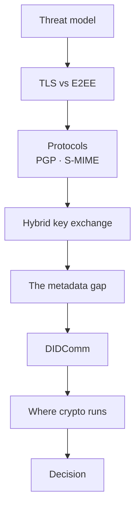

---

# Part 1 · The threat model

> **The idea:** standard email is an *open postcard*. Encryption adds an *envelope*.

**Form follows example:** a process → a labelled flow.

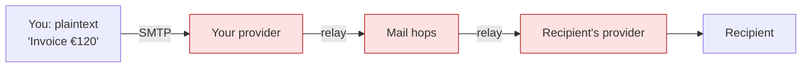

> **Readable at every red hop** — your provider, every relay, the recipient's provider. No envelope yet.

---

# There are TWO separate protections

> **One concept:** *transport* and *content* are independent layers. "Email encryption" usually means one, not both.

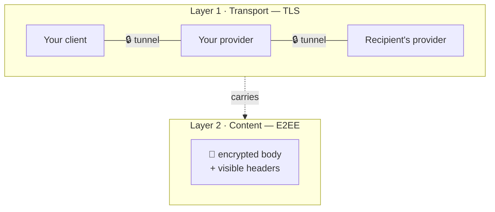

| Layer | Protects | Provider can still read… |
|---|---|---|
| **TLS** (in transit) | The pipe between servers | The body at rest |
| **E2EE** (content) | The message itself | Headers only |

---

# Layer 1 · TLS — the tunnel

> **One concept:** TLS protects the *connection*, not the message.

**Worked example — two hops, no content protection:**

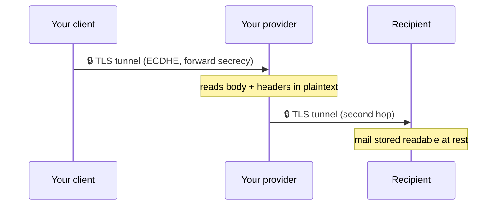

> **Result:** the pipe is safe from a passive wiretapper — but **your provider still reads everything**. TLS is not E2EE.

---

# Layer 2 · E2EE — the content

> **One concept:** E2EE encrypts the *body* so only sender and recipient hold the keys.

**Transformation:**

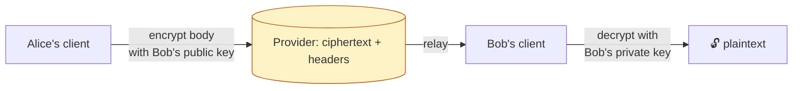

> **Result:** the provider stores and relays a blob it **cannot read**. Headers (From/To/Subject) are still visible.

---

# Part 2 · The two E2EE families

> **The one question that separates them:** *how is a public key bound to a real person?*

**Form follows example:** a tradeoff → an aligned comparison.

| | **OpenPGP** | **S/MIME** |
|---|---|---|
| Identity binding | **Web of Trust** — keys sign keys | **X.509 CA** — trusted root signs cert |
| Standard | RFC 4880 → **RFC 9580** (2024) | **RFC 8551** (v4.0, 2019) |
| Who vouches | Your peers | A certificate authority |
| Typical clients | Thunderbird, Proton, GPG | Apple Mail, Outlook, GWSMO |

> Two ways to answer "whose key is this?" — one peer-to-peer, one hierarchical.

---

# PGP / OpenPGP — the timeline

> **One concept:** PGP the product became OpenPGP the *open standard*.

**Transformation — 1991 → 2024:**

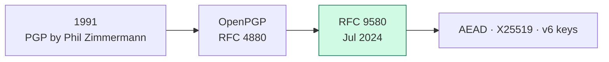

- **PGP** — proprietary software, Zimmermann 1991, now owned by **Broadcom**.
- **OpenPGP** — the open standard (RFC 4880 → **RFC 9580**, July 2024) so implementations interoperate.
- RFC 9580 adds **AEAD**, **Argon2**, **X25519/X448**, **v6 keys**.
- ⚠️ **Post-quantum (ML-KEM/ML-DSA) is still an IETF draft** — not in RFC 9580.

---

# OpenPGP trust · the Web of Trust

> **One concept:** trust flows because *people sign each other's keys* — there is no central authority.

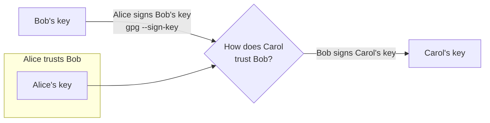

> **Weakness (honest):** chains are brittle; no authority means no revocation-by-default. That's the price of no central CA.

---

# S/MIME trust · the CA hierarchy

> **One concept:** trust is anchored in a **root CA** your client already has in its trust store.

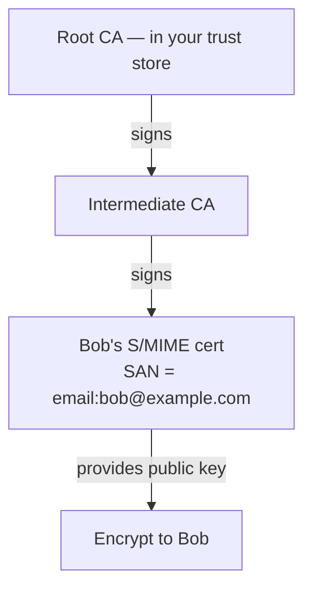

> **Chain check:** each signature valid under the parent's key → root is trusted → cert accepted. Break any link → warning.

---

# Platforms at a glance

> **One concept:** the same two protocols, deployed very differently. *Form: one table, no repetition.*

| Platform | Standard | Subject encrypted? | Key storage | Notes |
|---|---|---|---|---|
| **Proton Mail** | OpenPGP | ❌ plaintext | Client-side (JS) | Body E2EE; subject kept plaintext for PGP interop |
| **Tuta** | **TutaCrypt** (proprietary) | ✅ | Client-side | Hybrid X25519 + Kyber-1024 (2024); avoids PGP for subject privacy |
| **Thunderbird** | OpenPGP + S/MIME | ✅ (OpenPGP) | Local (GPG) | "Encrypt Subject" **predates** RFC 9788 |
| **Apple Mail** | S/MIME | ❌ | Keychain / Secure Enclave | See Part 7 for the P-256 vs RSA split |
| **Outlook (M365)** | S/MIME (+PGP add-ins) | ❌ | Windows cert store | Enterprise CA deployment |
| **Gmail Workspace** | S/MIME (hosted) | ❌ | Google-managed | Server-side S/MIME, GWSMO client |
| **PGPony (Android)** | OpenPGP | ✅ | **Smart cards** (NFC/USB) | Card-backed keys; active |
| **OpenKeychain (Android)** | OpenPGP | — | User-space RAM | Unmaintained (last v6.0.4, Feb 2024) |

---

# What a certificate actually is

> **One concept:** a certificate is a **signed public key** — it binds a key to an identity, and is attested by a signature. It **never contains the private key**.

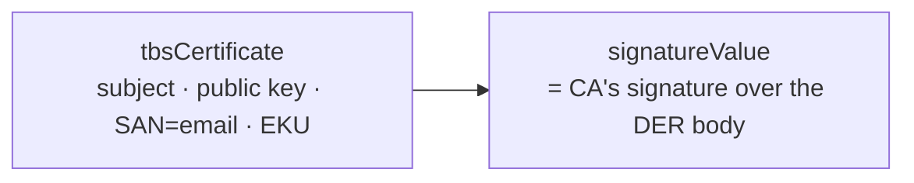

| S/MIME-specific field | Value |
|---|---|
| **Subject Alternative Name** | `email:alice@example.com` |
| **Extended Key Usage** | `id-kp-emailProtection` → **OID `1.3.6.1.5.5.7.3.4`** ⚠️ not `.3.12` |
| **Key Usage** | `digitalSignature` + `keyEncipherment` |

---

# Generation · how a sender gets a certificate

> **One concept:** a key pair is born, the public half gets signed, the private half never leaves you.

**Transformation — input → process → output:**

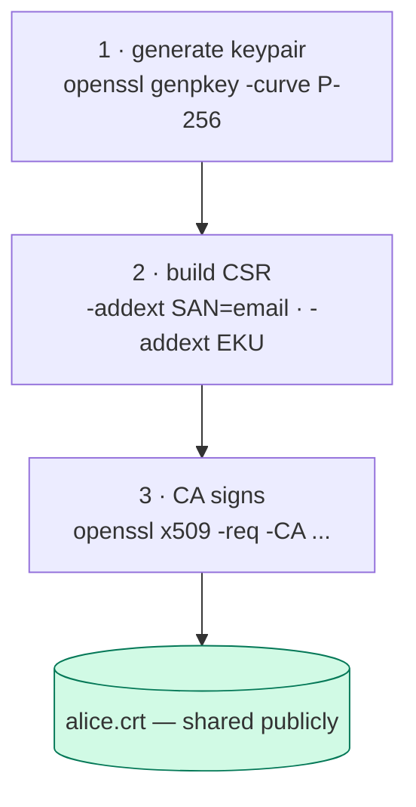

> **What's shared is `alice.crt`.** The private key stays secret and never travels.

---

# Part 3 · Hybrid key exchange

> **One concept:** combine a fast symmetric cipher with a slow-but-shareable asymmetric one.

**The problem it solves:**

| Symmetric (AES) | Asymmetric (RSA/ECC) |
|---|---|
| Very fast, but needs a shared key | Solves sharing, but ~1,000× slower |

> **Both are needed:** AES encrypts the bulk fast; RSA/ECC safely shares the key. Neither alone is enough.

---

# The hybrid — input → transform → outcome

> **One concept:** encrypt the body with AES, wrap the tiny session key with the recipient's public key.

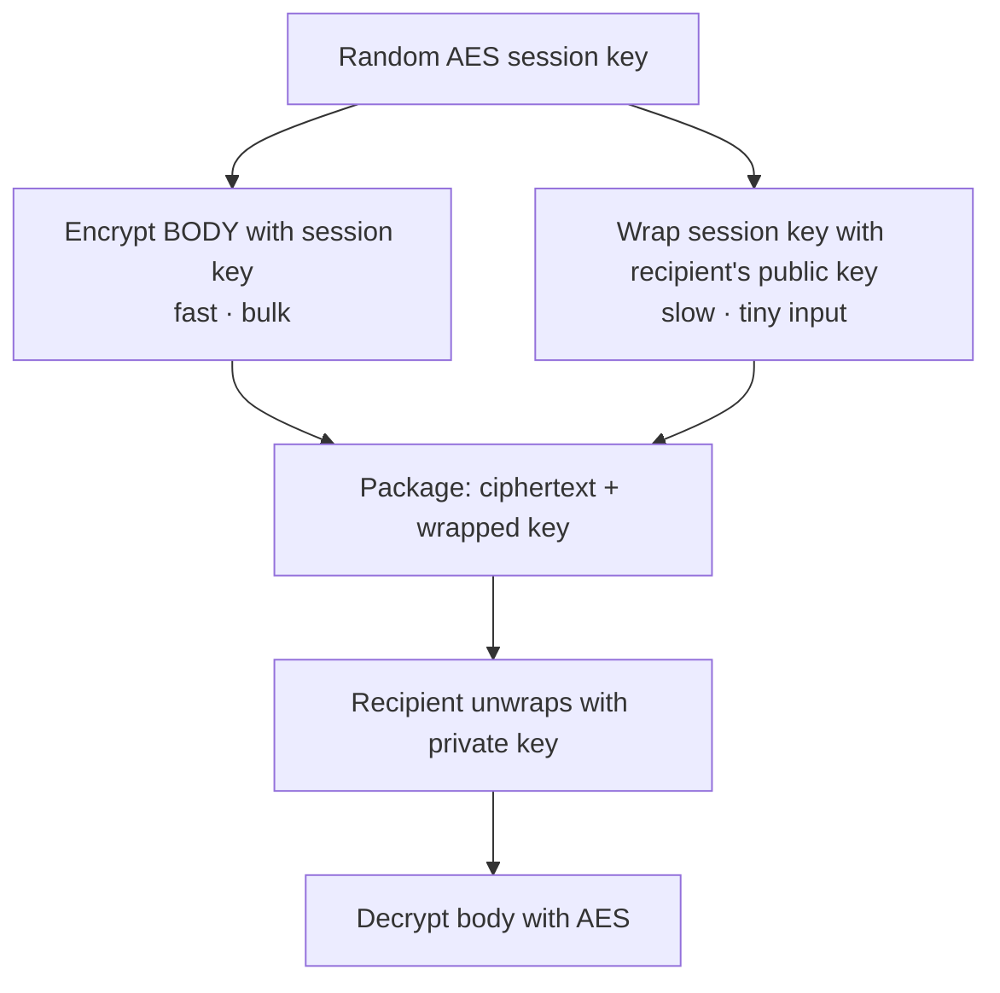

> The slow asymmetric op runs **once, on ≤256 bits**. That's the core trick.

---

# Multi-recipient

> **One concept:** encrypt the body once; wrap the same session key for each recipient.

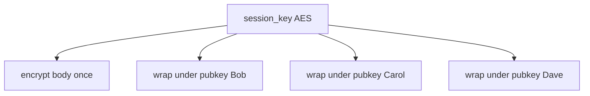

> Each recipient finds **their own wrapped copy** of the session key and decrypts it with their own private key.

---

# Receiver validates & decrypts

> **One concept:** the client *cryptographically verifies* the chain up to a trusted root, then decrypts.

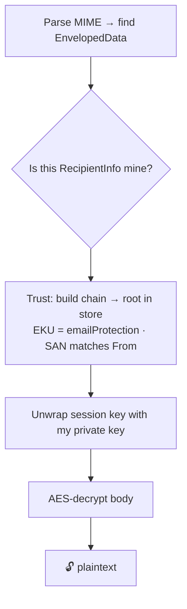

> **No magic:** chain invalid or root untrusted → warning/block. Otherwise → accept and decrypt.

---

# Part 4 · The secrets

> **One concept:** there are **two kinds** of secret, with very different blast radii.

| Secret | Lifetime | If it leaks |
|---|---|---|
| **Private key** | Years | Entire mailbox history **+ future** — no recovery, no rotation fixes the past |
| **Passphrase** | Years | Unlocks the private key → same as above |
| **Session key** | One message | Only that message |

> **Design goal:** minimize the blast radius of any one compromise. The session key limits per-message damage; the private key is the real risk.

---

# The forward-secrecy gap

> **One concept:** PGP/S-MIME use a *static* private key forever, so there is **no forward secrecy**.

**Form: a comparison — same scenario, two key models.**

| Scenario | TLS 1.3 (ephemeral DH) | PGP / S-MIME (static key) |
|---|---|---|
| Private key stolen in 2026 | Past sessions safe (ephemeral keys destroyed) | **All** messages ever encrypted exposed |
| One session key intercepted | No added risk | Only that one message |

> Signal's **Double Ratchet** (ephemeral key exchange) gives forward secrecy in messaging — it does **not** exist in classic email E2EE.

---

# Part 5 · The metadata problem

> **One concept:** an encrypted *body* still leaks an unencrypted *envelope*.

**Transformation — what the server sees:**

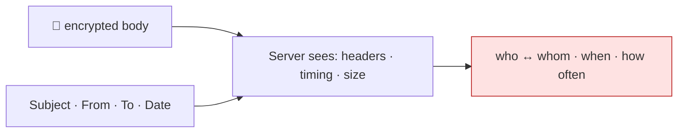

> The message is secret; **the envelope is public** — and the envelope is a communication graph.

---

# Protocol fix · RFC 9788 (subject)

> **One concept:** move sensitive headers *into* the encrypted payload, show a placeholder outside.

**Transformation — Subject line:**

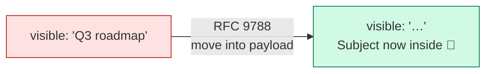

- **RFC 9788** (Aug 2025) standardizes this for **PGP and S/MIME**; adds end-to-end integrity for all headers.
- ⚠️ Thunderbird's "Encrypt Subject" **predates and is not an implementation of** RFC 9788.
- Does **not** solve From/To — SMTP needs them visible for routing.

---

# Transport fix · Encrypted Client Hello

> **One concept:** hide which mail server you're connecting to, not just the bytes you send.

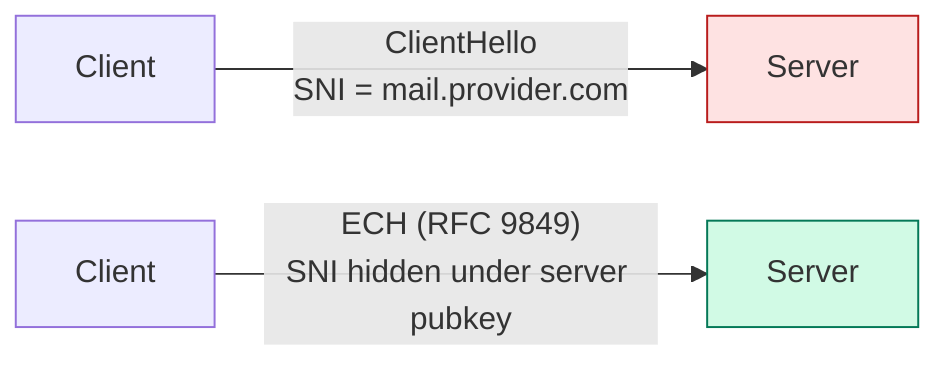

- **ECH (RFC 9849, March 2026)** encrypts the SNI (and ALPN) in the TLS handshake under an HPKE key.
- Observers no longer see *which* server you reach. A transport-level privacy win.

---

# Architectural workarounds (available now)

> **One concept:** sidestep the protocol; change *where* the encryption happens.

| Approach | How it hides metadata | Example |
|---|---|---|
| **Zero-access provider** | Custom protocol encrypts subject/contacts **client-side** | Tuta (TutaCrypt), Proton (body only) |
| **Sealed sender** | Sender's identity encrypted inside the envelope; server sees an opaque blob + delivery token | Signal (2018) — **no email equivalent yet** |

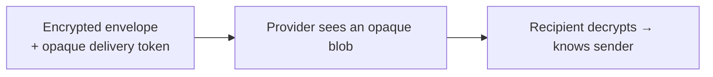

> Signal's **sealed sender** (Oct 2018): the model any future "sealed email" would follow.

---

# What's still unsolved

> **One concept:** From/To and timing/size are exposed *because SMTP requires them for routing*.

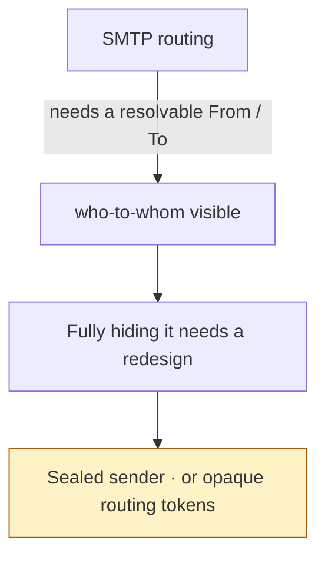

> **Honest limit:** no deployed email standard hides *who talks to whom* today. That's the hardest problem — and the reason for the next part.

---

# Part 6 · DIDs — opaque identifiers

> **One concept:** replace `alice@gmail.com` with an opaque, user-controlled identifier.

**Transformation:**

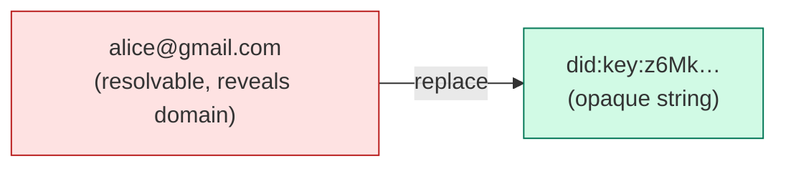

- An observer sees only an opaque string — **no name, no domain**.
- The **W3C DID spec lists privacy as a design goal** (Recommendation, July 2022).
- ⚠️ **Terminology:** `did:key` is generative/registry-less. **Veres One** (`did:v1`) is a separate method. Don't conflate them.

---

# DIDComm — the messaging layer

> **One concept:** DIDComm (v2, DIF-ratified — *not* an IETF RFC) hides the sender from intermediaries.

| Mode | What it hides |
|---|---|
| **anoncrypt** (ECDH-ES) | Sender identity from everyone except the recipient |
| **authcrypt** (ECDH-1PU) | Sender identity provable to the **recipient only** |

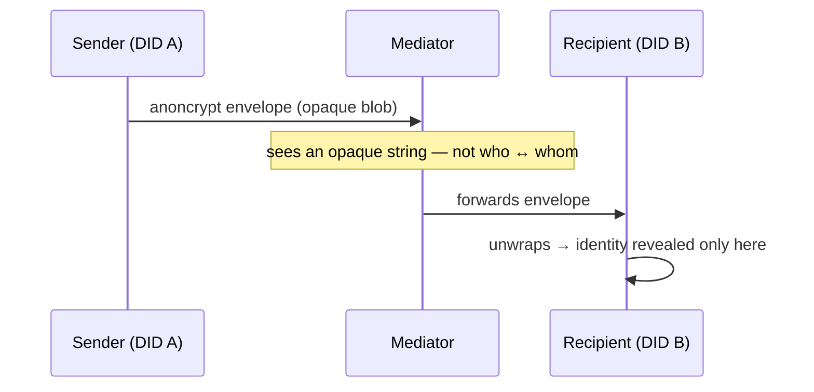

---

# DIDComm vs centralized email

> **One concept:** the same three dimensions — privacy, architecture, encryption — but different answers.

| Dimension | Centralized (SMTP + E2EE) | DIDComm + DIDs |
|---|---|---|
| Identity | `name@domain` (resolvable) | Opaque `did:key:…` |
| Privacy | Metadata visible to relays | anoncrypt/authcrypt hide sender |
| Architecture | Central relays / MX | Mediators, transport-agnostic (SMTP possible) |
| Encryption | Hybrid AES + long-term keys | ECDH-ES / ECDH-1PU envelopes |
| Standard | IETF RFCs (mature) | DIF-ratified — **no RFC, no DID-routed mail** |
| Deployment | Ubiquitous | **Experimental** |

---

# Why DIDs don't close the gap

> **One concept:** DIDs are a necessary building block, **not** a complete fix. Three leaks remain.

| Leak | Why it happens |
|---|---|
| **Correlation** | Reuse a DID → observers map your graph (W3C DID Core §10.2) |
| **DID doc leaks** | Resolution is a network request; a service endpoint like `https://alice.example.com/inbox` evaporates privacy (§10.6) |
| **No routing standard** | SMTP still needs a resolvable address; **Mailchain shut down May 2026** — it's experimental |

> Ephemeral DIDs fix correlation but break verification ("how do I know it's really you?") and create key-management overhead.

---

# Where DIDs actually help

> **One concept:** as a **complement**, not a replacement.

```mermaid {scale: 0.85}
flowchart LR
    DID[DID identity layer] --> A[Authenticate without<br/>revealing identity]
    DID --> B[Selective disclosure<br/>'over 21' via ZKPs]
    DID --> C[Identity for a<br/>sealed-sender-like transport]
```

> You still need the **transport layer** (sealed sender / mixnets) to hide *that a message was sent at all*, and **ephemeral identity rotation** to prevent correlation. Mixnets weaken *linkability*, not the existence of traffic.

---

# Part 7 · Where does the crypto actually run?

> **One concept:** the hybrid design maps to **two physical places** — and the session key is the bridge that crosses them.

```mermaid {scale: 0.6}
flowchart TB
    subgraph HW["🔒 Secure boundary: SE · TPM · smart card"]
        K[Private key] --> U[unwrap session key]
    end
    U -->|"session key EXITS here"| R[(Regular RAM / CPU)]
    R --> AES[AES-decrypt body]
    AES --> PT[🔓 plaintext]
```

| Operation | Where it runs | Why |
|---|---|---|
| Asymmetric (unwrap session key) | Secure hardware (if configured) | Small, fast, key never leaves |
| Symmetric (AES body decrypt) | Regular CPU + RAM | Bulk data — can't fit in an enclave |

> **The unavoidable gap:** the session key and plaintext always transit regular memory.

---

# Apple · two paths to the same gap

> **One concept:** the key's *location* depends on how you got it — and most certs are RSA in Keychain.

| Key type | Private key lives | Decryption runs |
|---|---|---|
| **ECC P-256 (SCEP enrollment)** | **Secure Enclave** (generated inside) | Inside the SE (ECDH) |
| **RSA (PKCS#12 import)** — most CAs | Keychain (encrypted at rest) | Regular CPU (Security framework) |

> ⚠️ The Secure Enclave **only accepts P-256 keys generated inside it** — you cannot import an existing RSA or P-256 key. Most CAs issue RSA, so the common case runs in **regular memory**.

---

# Android · why PGP stays in user-space

> **One concept:** the Keystore can't represent OpenPGP — and even when it could, the session key still comes back.

> ⚠️ **Correcting a myth:** Android Keystore/KeyMint **does** support RSA decryption. The real gap:

| Gap | Detail |
|---|---|
| Key types | OpenPGP's X25519/Ed25519, multi-key packets don't map to KeyMint ops |
| Padding / key access | Fixed paddings, no raw key material |
| Session key | Unwrapped key is returned to the app **anyway** — no hardware boundary |

- **OpenKeychain:** unmaintained (last v6.0.4, Feb 2024).
- **PGPony:** hardware-key-first — keys on **NFC/USB smart cards** do crypto **on-card**.
- **BSI (2016):** Keystore would need significant extension for OpenPGP.

---

# GnuPG + TPM 2.0 · shadowed keys

> **One concept:** the TPM wraps your key; the decrypt happens *inside* the chip.

```mermaid {scale: 0.7}
sequenceDiagram
    participant g as gpg
    participant a as gpg-agent
    participant t as tpm2daemon
    participant T as TPM
    g->>a: decrypt, key grip = XYZ
    a->>t: shadow type tpm2-v1 → divert
    t->>T: TPM2_Load (parent 81000001)
    t->>T: TPM2_RSA_Decrypt(session key)
    T-->>t: session key (inside TPM)
    t-->>a: session key → regular RAM
    a-->>g: AES-decrypt body
```

> `tpm2daemon` exposes only **IMPORT · PKSIGN · PKDECRYPT · KILLTPM2D**. The shadowed `tpm2-v1` key is useless without *that exact* TPM — but the session key is in RAM the moment it leaves.

---

# GnuPG + smart card · a self-contained HSM

> **One concept:** the private key physically lives on the card and can **never be exported**.

```mermaid {scale: 0.7}
sequenceDiagram
    participant g as gpg
    participant a as gpg-agent
    participant s as scdaemon
    participant C as Card (own CPU)
    g->>a: decrypt
    a->>s: key is on card (stub → serial)
    s->>C: APDU: VERIFY(PIN) → DECRYPT
    Note over C: PIN verified on-card · 3 tries → lockout
    C-->>s: session key (via APDU)
    s-->>a: regular RAM
    a-->>g: AES-decrypt body
```

> No ISO 7816 command reads the key. PIN is never sent in plaintext. **The session key still exits the card.**

---

# The universal session-key exit

> **One concept:** every platform protects the *private key*; none protects the *session key* in the open.

```mermaid {scale: 0.5}
flowchart TB
    subgraph B1["🔒 Secure boundary"]
        K[Private key] --> OP[asymmetric op] --> SK[session key]
    end
    SK -->|"EXITS (unavoidable)"| RAM[(REGULAR RAM / CPU)]
    RAM --> AES[AES decrypt] --> PT[🔓 plaintext]
```

| Private key in… | Session key in RAM? | Plaintext in RAM? |
|---|---|---|
| TPM / smart card / Secure Enclave / TEE | **Yes (exits)** | Yes |

> **That's the price of the hybrid design:** the private key can be locked away, but the session key always comes out.

---

# Threat model & how to close the gap

> **One concept:** hardware shrinks the window — it can't eliminate it.

| Attack | Protected | Exposed |
|---|---|---|
| Steal key file at rest | Private key (SE/TPM/card) | Nothing useful |
| Root OS / dump RAM | Private key (in hardware) | **Session key + plaintext** |
| Cold-boot (freeze RAM) | Private key (in hardware) | Session key + plaintext |
| Physical attack on chip | SE / StrongBox | TPM (not certified vs physical) |

**What closes the gap?**
1. **AES in the enclave** — no SE/TEE/TPM streams AES at mail speed.
2. **Confidential computing** (SGX/CCA/TDX) — key + plaintext stay in encrypted CPU memory.
3. **Post-quantum + hardware** — ML-KEM (RFC 9936) specified for S/MIME; nothing decrypts it.

---

# The decision, revisited

> **GOOD / the choice you leave with** — "which layer protects what I care about?"

```mermaid {scale: 0.9}
flowchart LR
    A["Body privacy?<br/>→ E2EE (PGP/S-MIME)"] --> D[Decide]
    B["In-transit safety?<br/>→ TLS"] --> D
    C["Who-to-whom hidden?<br/>→ not solved today<br/>(DIDs/mixnets next)"] --> D
```

- **Know your layers** — TLS ≠ E2EE.
- **The private key is the crown jewel**, and it has **no forward secrecy**.
- **Metadata** is the unsolved frontier (RFC 9788, ECH, zero-access, sealed sender).
- **DIDs/DIDComm** are the roadmap, not the finished product.
- **Secure hardware narrows** the blast radius but can't stop the session-key exit.

---

# Further reading

Open the companion **`GO-DEEPER.md`** for the full, verified internals — complete `openssl`/`gpg` command flows, TPM shadow-key and smart-card APDU details, and every RFC citation.

**Key references (all verified, Nov 2026)**

- OpenPGP: **RFC 9580** (2024) · S/MIME: **RFC 8551** · CMS: **RFC 5652** · X.509: **RFC 5280**
- Header Protection: **RFC 9788** (Aug 2025) · ECH: **RFC 9849** (Mar 2026) · ML-KEM for S/MIME: **RFC 9936** (Mar 2026)
- DIDs: **W3C DID Core** (Jul 2022) · **DIDComm v2** (DIF)
- Apple Platform Security Guide · Android KeyMint docs · GnuPG manual

<style>
  li { font-size: 1.02rem; line-height: 1.55; }
  table { font-size: 0.95rem; }
</style>